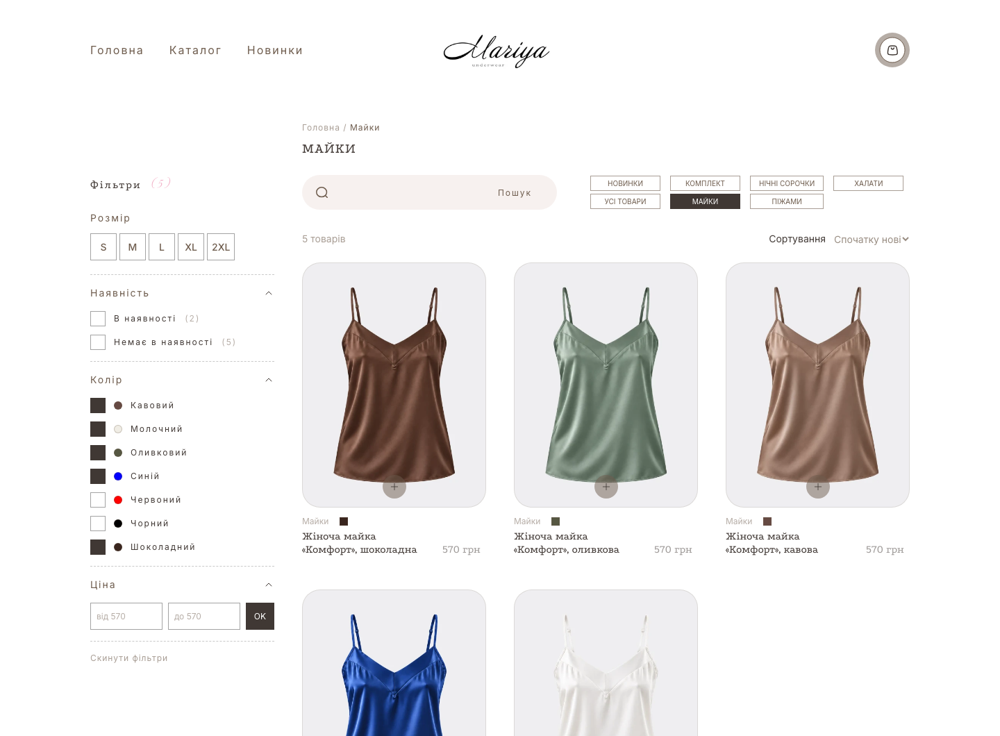
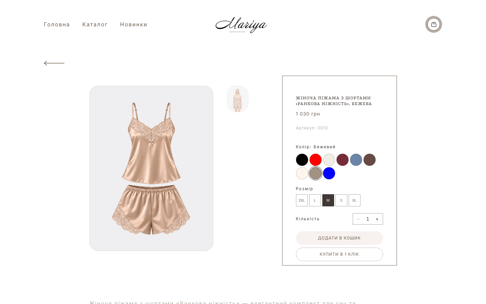
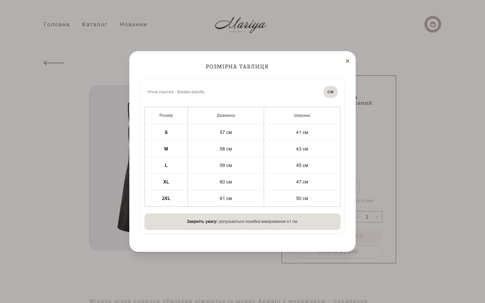
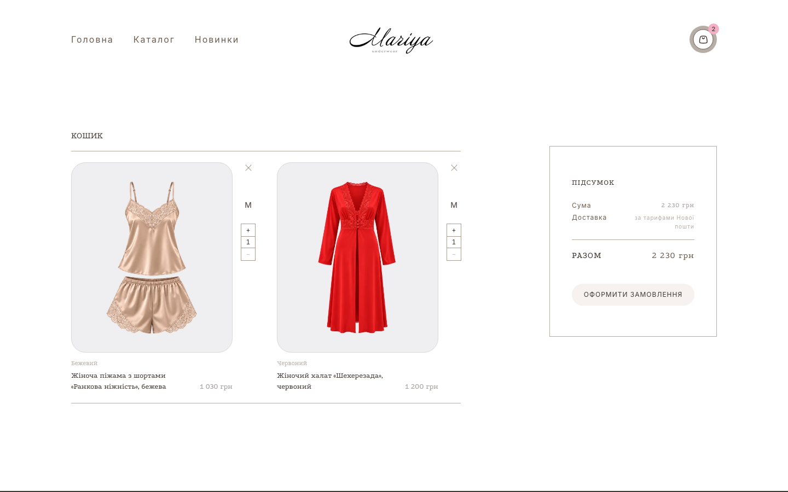
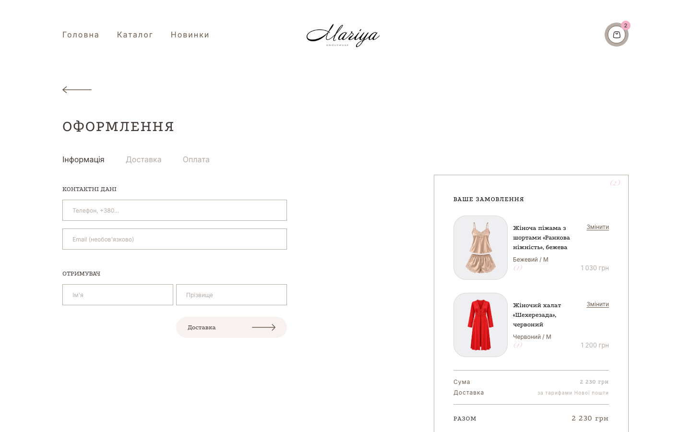
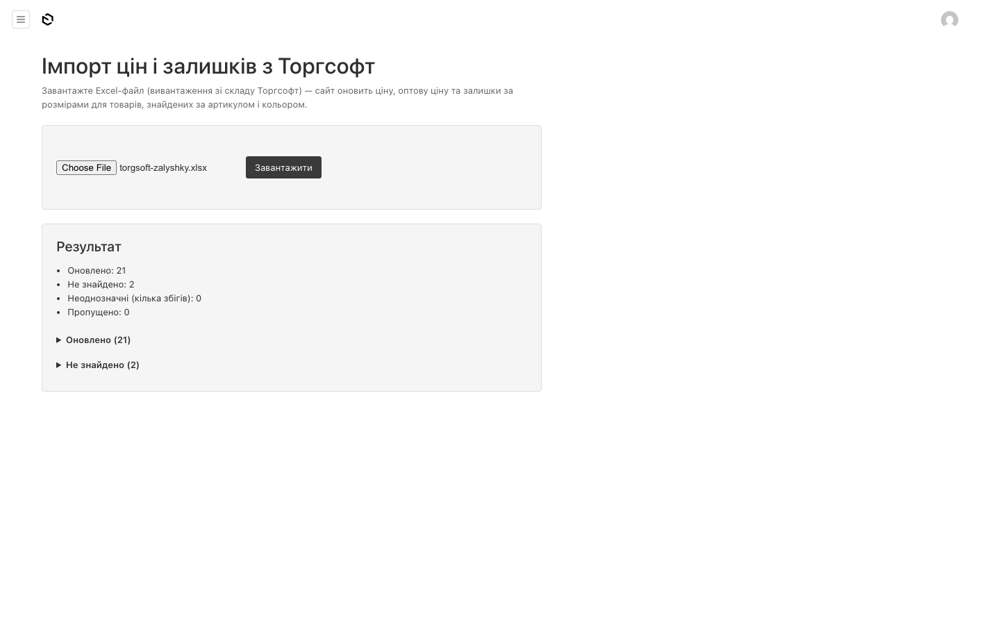
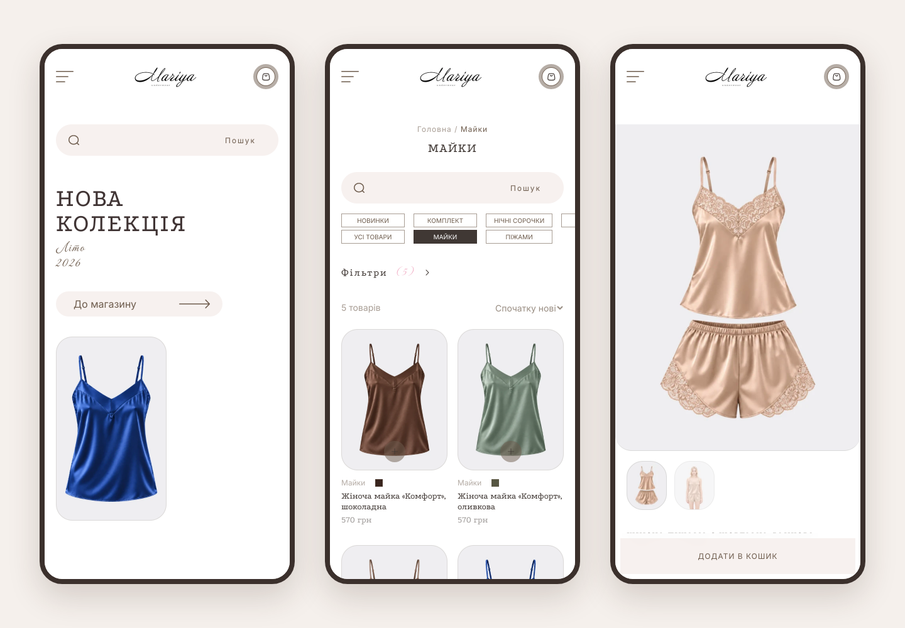
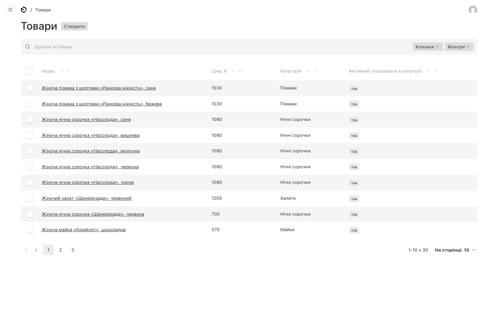

# Mariya Underwear

Online store for a Ukrainian lingerie and homewear brand, built from scratch to replace a Tilda site.

**Live:** [mariyaunderwear.com](https://mariyaunderwear.com/)


## Stack

- **Next.js 15** (App Router, Server Components), React 19, TypeScript, Tailwind CSS
- **Payload CMS 3**: runs inside Next.js, so the storefront, admin panel and API are one app
- **PostgreSQL**, **Cloudinary** for photos, **Resend** for email
- Deployed on **Railway**, with nightly database backups via GitHub Actions

## Features

- Catalog with categories, search, filters (size, color, price, stock) and sorting
- Product page: gallery, color switcher, sizes with live stock, size chart, related products
- Cart, checkout with Nova Poshta delivery, and a one-click quick order
- Orders are validated on the server: prices and stock are re-read from the database, and the endpoint is rate-limited
- Email to the store owner and a confirmation email to the customer for every order
- Admin panel in Ukrainian for non-technical staff
- Price and per-size stock import from Torgsoft (Excel/CSV), matched by SKU and color
- SEO: sitemap, robots.txt, JSON-LD product markup, canonical URLs

## Screenshots

| Catalog with filters | Product page |
|---|---|
|  |  |
| **Size chart** | **Cart** |
|  |  |
| **Checkout** | **Torgsoft import in the admin panel** |
|  |  |



<details>
<summary>Products in the Payload admin</summary>



</details>

## Run locally

```bash
npm install
cp .env.example .env   # DATABASE_URI, PAYLOAD_SECRET, Cloudinary and Resend keys
npm run db:up          # PostgreSQL in Docker
npm run dev            # http://localhost:3000, admin at /admin
```

The code structure is described in [CODEBASE.md](CODEBASE.md).
